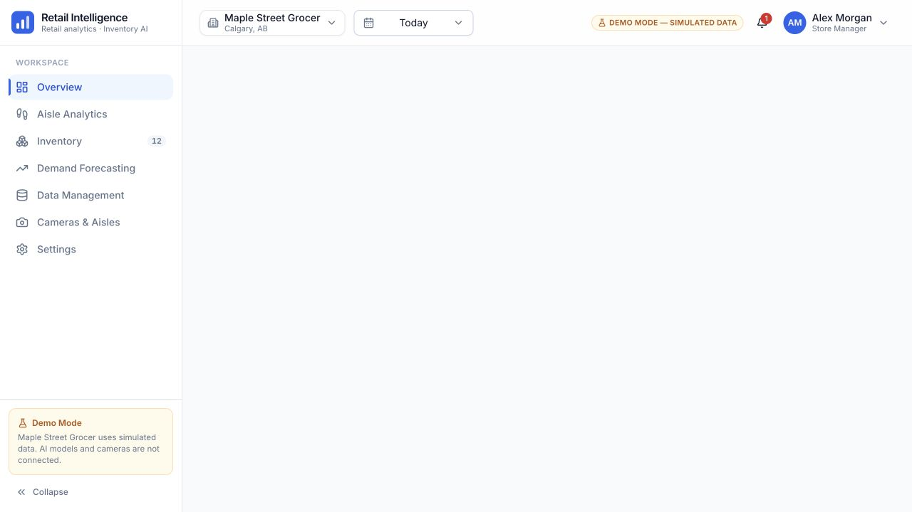
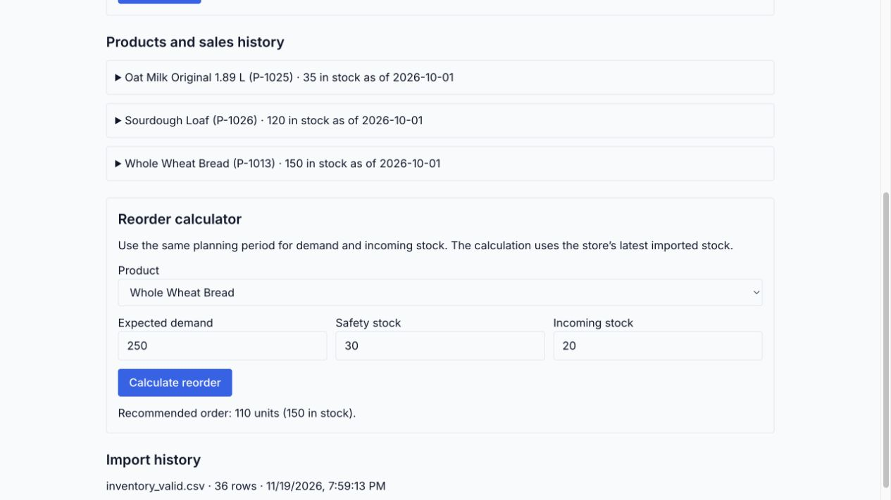

# Retail Intelligence

Retail Intelligence helps grocery-store managers import sales and stock data, review product history, and calculate how many units to reorder. This is an **inventory evaluation preview**. It includes a browser demo and a self-hosted inventory workflow.

Amirali Moradi developed Retail Intelligence for CPSC 598 Software Entrepreneurship at the University of Calgary. The project first appeared in the [repository published by faraz-hsn](https://github.com/faraz-hsn/AI-Inventory). This repository preserves that commit history. The project uses the [MIT license](LICENSE). The bundled [Inter font](public/INTER-LICENSE.txt) and other dependencies retain their own licenses.

## Try the sample store

[Open the online demo](https://amiralimoradii.github.io/retail-intelligence/) without an account, then use **Data Management** to try a valid and an invalid inventory CSV. In **Inventory**, review the updated Whole Wheat Bread history. In **Demand Forecasting**, select **Load example** for a 200-unit reorder calculation.

The public preview uses bundled synthetic data and stores changes in your browser. Aisle traffic and forecasts are simulated.



### Run the demo locally

Use Node.js 24 and npm.

```sh
npm ci
npm run dev
```

Open the URL printed by Vite. Select **Use demo account**, sign in, and finish or skip store setup. In **Data Management**, choose **Try a sample file**. The invalid quantity sample shows an error on row 8. The valid sample imports 36 rows across three products. Open **Inventory** to review the updated Whole Wheat Bread history. In **Demand Forecasting**, select **Load example** to see how the reorder calculation produces 200 units.

The demo saves changes in your browser. Use bundled samples or synthetic records. Demo sign-in, aisle analytics, camera processing, and demand forecasts are simulated. [Demo walkthrough](docs/DEMO_SCRIPT.md)

## Try the self-hosted inventory workflow

Build the app with the store inventory page enabled. Run these commands from the repository root. Use a password manager to generate a distinct password of at least 12 characters. The Bash example reads it without echoing it or adding it to shell history.

```bash
npm ci
VITE_STORE_INVENTORY=1 npm run build
read -r -s -p 'Evaluation password: ' retail_password
printf '%s\n' "$retail_password" | node backend/provision.mjs manager@preview.example maple-eval "Maple Evaluation" manager
unset retail_password
node backend/server.mjs
```

Open `http://127.0.0.1:8787/store-inventory` and sign in with the account you created. Import `sample-data/inventory_valid.csv` and expand Whole Wheat Bread to see its monthly history. Enter expected demand of 250, safety stock of 30, and incoming stock of 20. With 150 units on hand, the recommendation is 110 units. Refresh the page to see that the inventory remains available.

Store data and sessions are stored in SQLite at `.ri-data/inventory.sqlite` by default. Set `RI_DB_PATH` for both the provisioning command and the server to use a different file. The server binds to loopback by default. Use the `viewer` role to provision read and reorder access without import access. For frontend development with the API running on port 8787, use `VITE_STORE_INVENTORY=1 npm run dev`.



### Inventory CSV rules

- Required columns are `product_id`, `product_name`, `date`, `ordered_quantity`, and `sold_quantity`. Optional columns are `category`, `current_stock`, `supplier_lead_time`, and `unit_cost`. Use `YYYY-MM-DD` for dated stock counts. A month-only value is treated as the first day of that month.
- Each file supplies complete totals for the product-months it includes. Multiple rows for the same product-month are summed. A later upload replaces the affected monthly totals and preserves omitted months.
- A stock count is applied only if its date is at least as recent as the saved count. Missing stock stays unknown until a count is imported. Repeating an identical file returns the original import receipt, including when the file is renamed.
- Each upload is limited to 5 MiB and 25,000 rows in store mode. Rejected files leave the stored inventory unchanged.
- The reorder rule is `max(0, expected demand + safety stock − on-hand stock − incoming stock)`. Use the same planning period for demand and incoming stock. The calculator gives advice and does not submit an order.

## Verify or contribute

```sh
npm run typecheck
npm test
npm run benchmark:forecast
VITE_STORE_INVENTORY=1 npm run build -- --outDir dist/store
VITE_PUBLIC_DEMO=1 npm run build -- --base /retail-intelligence/ --outDir dist/demo
npx playwright install chromium
npm run test:e2e
```

GitHub Actions is configured to run the same checks after a clean install. The automated suite exercises CSV validation, store isolation, viewer permissions, import retries, dated stock, and persistence across a server restart. Chromium tests both builds at desktop and phone widths. See [Contributing](CONTRIBUTING.md) before opening a pull request. For a change to import behavior, include a small synthetic CSV that shows what should happen. For UI changes, include the route and steps for testing with a keyboard and a phone-width viewport.

The forecast benchmark holds out the last three months for each of 24 synthetic products. Predicting the last observed month scores 27.40 units MAE and 12.38% WAPE. The two versions of the demo heuristic score 24.74 and 25.74 units MAE, and 11.18% and 11.63% WAPE. Real-store performance and model-specific accuracy still require testing on representative data.

## Before a store pilot

See the [pilot operations runbook](docs/PILOT-OPERATIONS.md) for account administration and backup drills, and the [forecast evaluation guide](docs/FORECAST-EVALUATION.md) for checking monthly demand baselines.

Validate the CSV conventions against a store's exports and agree on how staff handle adjustments, stock dates, and planning periods. Deploy behind HTTPS with `RI_SECURE_COOKIE=1`, put SQLite on backed-up durable storage, test restoration, and establish account recovery, revocation, and audit monitoring. The preview uses local provisioning and has no account administration UI. Start with inventory and review the results with staff before making purchasing decisions from them.

Camera ingestion is a separate milestone. Agree on the purpose and authorized viewers before collecting any footage. Define retention and deletion for raw video and aggregate metrics, encrypt storage and transport, test deletion and access logging, and validate aisle-count accuracy and camera coverage. The demo does not connect to cameras or run computer vision.
